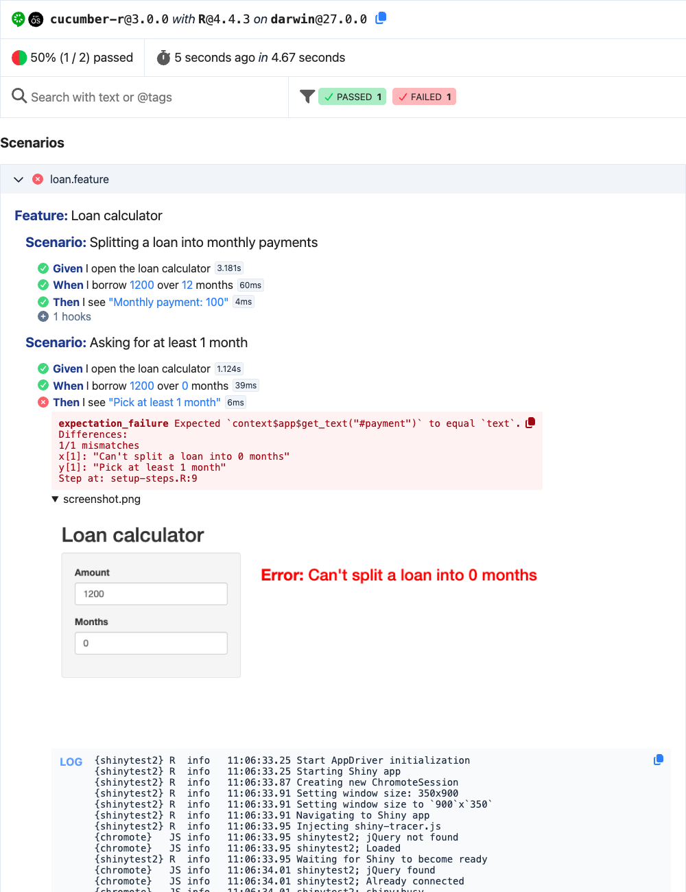

# Reports

A run of
[`cucumber::test()`](https://jakubsob.github.io/cucumber/dev/reference/test.md)
prints its progress to the console. To keep its results, write its
report: a page with every feature, scenario and step, and what the steps
attached, like screenshots and logs.

## The HTML report

`CucumberHtmlReporter` writes the official Cucumber HTML report when the
run ends, even when it fails: one file that works offline, where
features can be searched and filtered by status, text and tags. Combine
it with a reporter that prints, to see the progress of the run too:

``` r

cucumber::test(
  reporter = cucumber::CucumberMultiReporter$new(list(
    cucumber::CucumberProgressReporter$new(),
    cucumber::CucumberHtmlReporter$new("cucumber-report.html")
  ))
)
```

`CucumberJunitReporter` writes the JUnit XML report the same way, for CI
services to show the results of the run.

## Report a run after it ran

A reporter gets the run as [Cucumber
Messages](https://github.com/cucumber/messages).
`CucumberMessagesReporter` stores them, one line of JSON each, and the
`report()` method of any reporter reports the run from them later:

``` r

cucumber::test(reporter = cucumber::CucumberMessagesReporter$new("cucumber.ndjson"))

cucumber::CucumberHtmlReporter$new("cucumber-report.html")$report("cucumber.ndjson")
cucumber::CucumberJunitReporter$new("cucumber-junit.xml")$report("cucumber.ndjson")
```

## Attach screenshots and logs

A step or a hook attaches data to the report with its `context`:

- `context$attach(data, media_type, file_name)` attaches a string or a
  raw vector, like an image read with
  [`readBin()`](https://rdrr.io/r/base/readBin.html).
- `context$log(text)` attaches text to read.
- `context$link(...)` attaches links: each argument is a URL or a
  character vector of URLs, like
  `context$link("https://example.com/basket", "https://example.com/checkout")`.

The report shows each attachment under the step it’s attached to. See
[`?attachments`](https://jakubsob.github.io/cucumber/dev/reference/attachments.md).

## Screenshots and logs of a failing shinytest2 scenario

When a scenario of a Shiny app fails, seeing the app is often the
fastest way to know why. This example attaches a screenshot of the app
and its logs to the step that failed. Its files are in
[`inst/examples/shinytest2_report`](https://github.com/jakubsob/cucumber/tree/main/inst/examples/shinytest2_report).

The app splits a loan into monthly payments. It has a bug: for 0 months
it fails instead of asking for at least 1 month.

``` r

library(shiny)

ui <- fluidPage(
  titlePanel("Loan calculator"),
  sidebarLayout(
    sidebarPanel(
      numericInput("amount", "Amount", value = 1000, min = 0),
      numericInput("months", "Months", value = 10, min = 0)
    ),
    mainPanel(
      h3(textOutput("payment"))
    )
  )
)

server <- function(input, output) {
  output$payment <- renderText({
    message("Calculating the payment of ", input$amount, " over ", input$months, " months")
    # A bug: 0 months should ask for at least 1 month instead of failing
    if (input$months == 0) stop("Can't split a loan into 0 months")
    paste("Monthly payment:", input$amount / input$months)
  })
}

shinyApp(ui, server)
```

The specification describes what the app should do:

``` feature
Feature: Loan calculator
  Scenario: Splitting a loan into monthly payments
    Given I open the loan calculator
    When I borrow 1200 over 12 months
    Then I see "Monthly payment: 100"

  Scenario: Asking for at least 1 month
    Given I open the loan calculator
    When I borrow 1200 over 0 months
    Then I see "Pick at least 1 month"
```

The steps drive the app with
[`shinytest2::AppDriver`](https://rstudio.github.io/shinytest2/reference/AppDriver.html),
kept in the `context`:

``` r

given("I open the loan calculator", function(context) {
  context$app <- shinytest2::AppDriver$new(testthat::test_path("../../"), name = "loan", width = 900, height = 350)
})

when("I borrow {int} over {int} months", function(amount, months, context) {
  context$app$set_inputs(amount = amount, months = months)
})

then("I see {string}", function(text, context) {
  expect_equal(context$app$get_text("#payment"), text)
})
```

An
[`after_step()`](https://jakubsob.github.io/cucumber/dev/reference/hook.md)
hook attaches the screenshot and the logs when a step fails, and an
[`after()`](https://jakubsob.github.io/cucumber/dev/reference/hook.md)
hook stops the app:

``` r

# When a step fails, attach a screenshot of the app and its logs to the step
after_step(function(context, step) {
  if (step$status == "failed" && !is.null(context$app)) {
    file <- tempfile(fileext = ".png")
    context$app$get_screenshot(file)
    context$attach(readBin(file, "raw", file.size(file)), "image/png", file_name = "screenshot.png")
    context$log(paste(format(context$app$get_logs()), collapse = "\n"))
  }
})

# Stop the app after each scenario
after(function(context, scenario) {
  if (!is.null(context$app)) context$app$stop()
})
```

The hook attaches them in
[`after_step()`](https://jakubsob.github.io/cucumber/dev/reference/hook.md),
so they’re attached to the step that failed and shown under it.
Attachments of an
[`after()`](https://jakubsob.github.io/cucumber/dev/reference/hook.md)
hook are shown under the hook, which the report folds away when the hook
passes.

Run the scenarios, showing their progress and writing the report:

``` r

# Run the scenarios, showing their progress and writing the HTML report.
cucumber::test(
  "tests/acceptance",
  reporter = cucumber::CucumberMultiReporter$new(list(
    cucumber::CucumberProgressReporter$new(),
    cucumber::CucumberHtmlReporter$new("cucumber-report.html")
  )),
  stop_on_failure = FALSE
)
```

shinytest2 skips its apps on CRAN, and it takes any run for a CRAN run
unless the `NOT_CRAN` environment variable is `"true"`.
`devtools::test()` sets it, and
[`cucumber::test()`](https://jakubsob.github.io/cucumber/dev/reference/test.md)
sets it too when it isn’t set, outside of a testthat run and R CMD
check.

The report shows the failed step with its error, the screenshot of the
app with the error it shows, and the app’s logs, with the R error and
where it was raised:



The failed step in the HTML report, with the screenshot of the app and
its logs

[Open the
report](https://jakubsob.github.io/cucumber/shinytest2-report.html) to
see it as it’s written.

## Keep the report of a CI run

In CI, keep the report as an artifact of the job, even when the run
fails. With GitHub Actions:

``` yaml
- name: Run the scenarios
  run: |
    cucumber::test(
      reporter = cucumber::CucumberMultiReporter$new(list(
        cucumber::CucumberProgressReporter$new(),
        cucumber::CucumberHtmlReporter$new("cucumber-report.html"),
        cucumber::CucumberJunitReporter$new("cucumber-junit.xml")
      ))
    )
  shell: Rscript {0}

- uses: actions/upload-artifact@v4
  if: always()
  with:
    name: cucumber-report
    path: |
      cucumber-report.html
      cucumber-junit.xml
```

## Reports of your own

[`read_messages()`](https://jakubsob.github.io/cucumber/dev/reference/read_messages.md)
reads the messages as tibbles of the run’s features, scenarios and
steps, with their status, duration and error. Use it to write a report
of your own, like a summary of the failed steps for a CI job.
